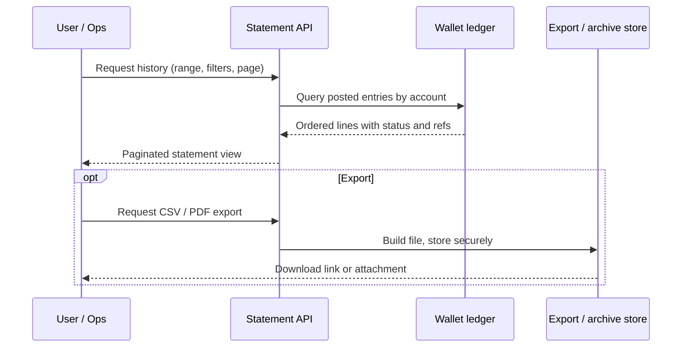

# Digital Wallet Statement History

An educational guide to **transaction statements** on a digital wallet or mobile wallet platform: how customers and operators view, filter, and export history, what fields belong on a statement line, and how statements support disputes and reconciliation. Written for operators, fintechs, and product teams looking at platforms in the [EVD System](https://evdsystem.com/) and [MoboGage](https://evdsystem.com/about-mobogage/) family.

---

## What Is Wallet Statement History?

**Wallet statement history** is the chronological record of money movement on a stored-value account: cash-in, cash-out, P2P transfers, merchant payments, fees, reversals, and adjustments. Customers use it to understand their balance. Operators use it to investigate complaints, prove what happened, and reconcile with partner systems.

A statement is not just a list of amounts. Each line needs enough context that a support agent — or the customer themselves — can answer: *What was this? When? Who was the other party? Did it succeed? Was it reversed?*

### Typical use cases

- **Consumers** checking recent spend, downloads for tax or expense tracking, and disputes on unknown charges
- **Merchants** exporting settlement history for bookkeeping
- **Agents** reviewing float movements and commission credits
- **Operations** matching wallet lines to bank, switch, or voucher partner reports

---

## How It Works

### Core components

| Component | Responsibility |
|-----------|----------------|
| **Ledger query service** | Reads posted entries by wallet ID, date range, type, and status |
| **Enrichment layer** | Adds counterparty labels, channel, merchant name, and human-readable type |
| **Pagination and filters** | Cursor or page tokens so large histories stay fast |
| **Export builder** | Produces CSV, PDF, or signed API payloads for the same data |
| **Retention / archive** | Keeps hot recent history fast; older months move to cheaper storage |
| **Dispute linkage** | Lets support open a case from a specific statement line and reference |

See [docs/statement-fields.md](./docs/statement-fields.md) for a field checklist and export notes.

---

## Statement Line Essentials

| Field | Why it matters |
|-------|----------------|
| **Timestamp (with timezone)** | Avoids "wrong day" disputes across borders |
| **Unique transaction ID** | Idempotent lookups and bank/switch matching |
| **Type and subtype** | Cash-in vs transfer vs fee vs reversal |
| **Amount and currency** | Signed or debit/credit clearly shown |
| **Running balance (optional)** | Helps customers; some regulators expect it |
| **Status** | Completed, pending, failed, reversed |
| **Counterparty / channel** | Who or what the other side was |
| **Original vs reversal link** | Ties a refund to the parent transaction |

---

## Design Considerations

- **Same data for UI and export.** The CSV a customer downloads should not invent fields the app never showed.
- **Timezone honesty.** Store UTC; display in the customer's or operator's preferred zone with a clear label.
- **Pending is not history.** Only show pending when you can later update or remove it without confusing the customer.
- **Reversals as first-class lines.** A reversal should appear as its own line pointing at the original, not as a silent balance change.
- **PII and masking.** Mask full account numbers and PINs on statements; keep full detail in restricted ops views.
- **Rate-limit exports.** Bulk downloads are useful for merchants and a vector for scraping; authenticate and throttle.
- **Immutable posted history.** Corrections go through adjustment or reversal entries, not edits to old lines.

MoboGage's EVD System platform includes digital wallet and mobile money capabilities, with cash-in, cash-out, transfers, and reversals on the same ledger as voucher and top-up services — so statement history can span those products in one view when the operator designs it that way.

---

## FAQ

**What belongs on a digital wallet statement?**
Every posted ledger event that changed the wallet balance (or was meant to), plus enough metadata to explain type, status, counterparty, and references for support.

**Should failed attempts appear?**
Usually yes for transparency, clearly marked as failed and with zero balance impact. Some products hide noise-level declines; document the choice.

**How long should history be retained?**
Follow local e-money and AML retention rules. Practically: hot storage for recent months, archive for the regulatory window, with exports still available to the customer where required.

**How do statements help disputes?**
A support agent picks the line, sees the original reference and status, and can open a case without reconstructing the story from logs alone.

**How does this relate to MoboGage / EVD System?**
MoboGage provides wallet and mobile money capabilities within EVD System. See [wallet cash-in, cash-out, transfers and reversals](https://evdsystem.com/evd-software/wallet-cash-in-out-transfers-and-reversals/) and [about MoboGage](https://evdsystem.com/about-mobogage/).

---

## Glossary (short)

- **Statement line** — one posted event on a wallet, with amount, type, status, and references
- **Running balance** — balance after each line in chronological order
- **Export** — machine-readable or printable dump of the same history
- **Reversal link** — pointer from a correcting entry back to the original transaction
- **Retention window** — how long history stays available to customers and auditors

---

## Further Reading / Related Industry Resources

- [Wallet cash-in, cash-out, transfers and reversals](https://evdsystem.com/evd-software/wallet-cash-in-out-transfers-and-reversals/) — how MoboGage handles wallet money movement
- [Mobile money platform with merchant payment](https://evdsystem.com/mobile-money-platform-with-merchant-payment/) — wallet and mobile money product context
- Related repo: [mobile-wallet-platform-guide](https://github.com/iwtglobal/mobile-wallet-platform-guide) — the building blocks of a mobile wallet platform

---

## License

Documentation in this repository is provided under the MIT License. See [LICENSE](./LICENSE).

*Educational material only. Not legal, regulatory, or financial advice. MoboGage and EVD System refer to offerings on evdsystem.com.*
